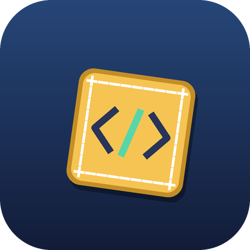

# Autopatcher build 

Pick a Minecraft version, download its patcher, run it with **your own** official client jar.

- **What this repo is:** the public side. It holds the build workflow, a small website (`site/`) and the scripts. It holds no secrets and no Minecraft files.
- **What the build does:** [`build-patcher.yml`](.github/workflows/build-patcher.yml) checks out the private patcher repo (`pxdns/eaglercraft-26.2`) with a token kept in an Actions secret, builds the patcher jars, checks that no Minecraft jar or game class is inside them, and publishes it as a **GitHub Release** here.
- **What it does not do:** it never stores or publishes Mojang's client jar or a built client. The official jar is downloaded on the runner only to verify the target descriptor, and is thrown away with the runner.

## Status

| Version | State |
| --- | --- |
| 26.2 | builds the patcher GUI and CLI jars only (no patch bundle, skeleton or overlay: those are not in the source repo) |
| 26.3, 1.16.5, 1.14, 1.12 | not started in this build. The 1.12 and 1.14 patch tools now live in `patcher/` of pxdns/zephr-source and pxdns/zephr-1.14-source. |

**Run history.** Run 1 failed because the token could not read the wrong repo; run 2 checked out `pxdns/eaglercraft-26.2` but expected a `targets/26.2.json` descriptor that repo does not have. The workflow now only builds `src/patcher/patcher/java-cli/build.sh`; its first run with this design is pending.

## Setup (once)

See [docs/SETUP.md](docs/SETUP.md): create a read-only token for the private repo, add it as the `PATCHER_TOKEN` secret, and turn on GitHub Pages for the `site/` folder.

## Using a release

1. Download `Eaglercraft-<version>-Setup.jar` from the [Releases](../../releases) page (or the site).
2. Run it with Java 17 or newer: `java -jar Eaglercraft-<version>-Setup.jar`.
3. Choose your own official client jar for that version, then build.

## Licence

GPL-3.0-or-later with an additional permission for combining with Minecraft ([`LICENSE`](LICENSE), [`LICENSE-EXCEPTION.txt`](LICENSE-EXCEPTION.txt)). What the project does and does not contain, and the projects it builds on, are in [`NOTICE.md`](NOTICE.md). Not legal advice.

## Rules for this repo

- Never commit a token, a Minecraft jar, or a build of the game.
- Builds start only by hand (`workflow_dispatch`). Do not add triggers that run on pull requests, because a pull request's code could then reach the secret.
- Large files go in Releases, not in commits.

Not affiliated with Mojang or Microsoft. Credit: the "download the patcher, run it with your own jar" approach follows the Eaglercraft 26.2 patcher by matej.
